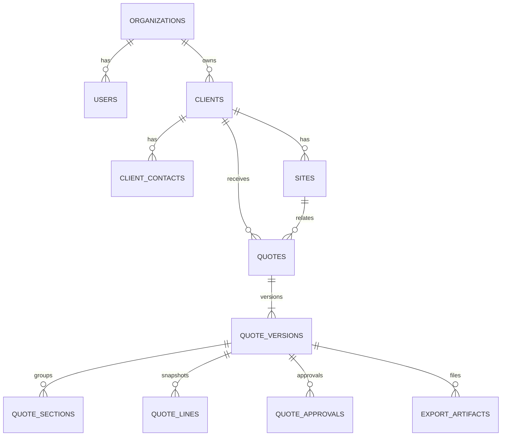

# 데이터 모델 설계 초안

DB 연결·최초 마이그레이션을 구현했다. PRD 9절의 전체 모델을 유지하며 현재는 인증 테이블, 회사·membership, 거래처·현장, 견적·버전·정규화 행, 감사 로그까지 포함한다. 아래 ERD의 연락처·공종·승인·출력물은 후속 구현이다.

- UUID, DATE, TIMESTAMPTZ, NUMERIC을 사용한다. 금액 정밀도는 최대 행 수와 요율 계산을 포함한 상한으로 결정한다.
- 회사별 견적번호, 견적별 차수에 유니크 제약. 현재 버전은 동일 견적 소속을 보장한다.
- 초안 row_version과 견적 revision_no를 구분한다.
- 제출본에는 품목·가격·세율·계산 정책·회사/거래처 표시 정보·조건·템플릿 버전을 보존한다.
- 발송 파일은 오브젝트 키·해시·버전·고객/내부 용도를 연결한다.
- 변경·감사·outbox 기록은 같은 트랜잭션. 비밀값은 감사에 기록하지 않는다.
- 조직 범위는 회사 단위 무결성을 위한 필드이며 다중 회사 SaaS 기능을 추가하는 것이 아니다.

행의 수량·단가는 NUMERIC(18,6), 견적 합계는 NUMERIC(40,0)이다. 원가 등 금액을 JS number로 변환하지 않는다. 버전 정책은 JSONB 스냅샷, 품목은 정규화 행으로 저장한다. 회사·거래처·현장 소속은 현재 서비스 트랜잭션에서 검증하며 복합 FK 보강은 후속 작업이다.

전체 FR 데이터 모델, 제출본의 DB 수준 불변 제약, 삭제·보존 정책, 승인 및 현재 버전 연결은 후속 마이그레이션에서 상세화한다. 초기 스키마의 인증 UUID 기본값은 외부 적용 전 SQL과 snapshot을 직접 보완했고 새 테스트 DB에 적용해 검증했다.
